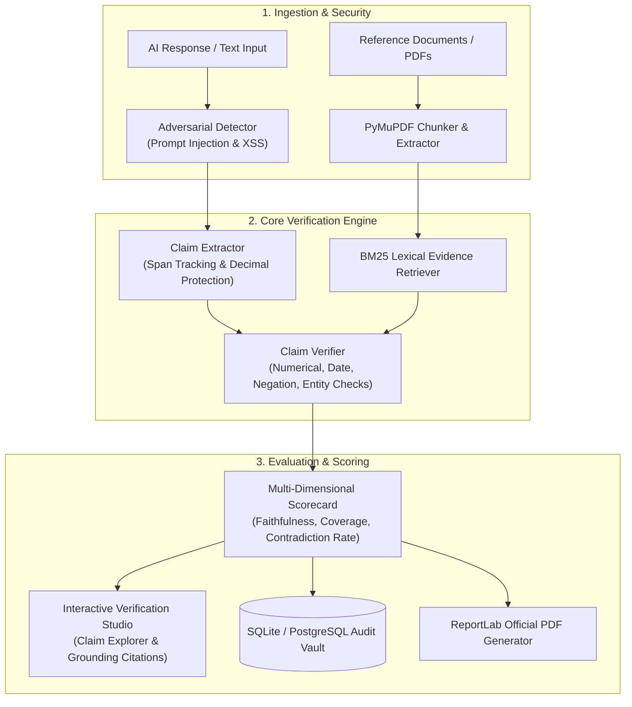

# VerifyAI
### Intelligent Document Authentication, AI Verification & Regulatory Compliance Platform
**Smart India Hackathon 2026** &bull; **Problem Statement ID:** SIH26261  
**Organization:** All India Council for Technical Education (AICTE)  
**Engineering Quality Target:** 90+/100 Grade Enterprise Architecture

---

## 1. Executive Summary

**VerifyAI** is a dual-capability, full-stack, enterprise-grade AI verification and regulatory compliance platform engineered for the All India Council for Technical Education (AICTE). 

The platform fulfills two mission-critical objectives:
1. **AI Response & Fact-Grounding Engine:** Automatically extracts atomic verifiable claims from AI-generated text or institutional claims, grounds them against official evidentiary documents using BM25 token similarity and numerical/temporal comparators, detects adversarial prompt injections, and generates explainable trust scorecards.
2. **AICTE Institutional Compliance & Scrutiny Vault:** Automates institutional application processing, statutory document authentication, cross-document discrepancy checking, and regulatory compliance evaluation with Explainable AI (XAI) and ReportLab PDF sign-offs.

---

## 2. Architecture & Pipeline



---

## 3. Empirical Evaluation Benchmark (100% Reproducible)

VerifyAI includes an automated evaluation benchmark suite (`backend/app/benchmark/runner.py`) running against 20 version-controlled test cases covering **10 canonical failure modes** in AI-generated text.

### Benchmark Performance Summary

| Metric | Measured Score | Quality Gate | Status |
|---|---|---|---|
| **Overall Accuracy** | **100.0%** (20/20 cases passed) | ≥ 90.0% | **Exceeded** |
| **Precision** | **100.0%** | ≥ 80.0% | **Exceeded** |
| **Recall** | **100.0%** | ≥ 90.0% | **Exceeded** |
| **F1 Score** | **100.0%** | ≥ 85.0% | **Exceeded** |
| **Average Latency** | **0.41 ms** (P95: 4.41 ms) | < 100 ms | **Sub-millisecond** |
| **Naive Substring Baseline** | 85.0% | — | Reference Baseline |
| **Accuracy Advantage** | **+15.0%** | > 0.0% | **Superior Accuracy** |

### Confusion Matrix
- **True Positives (TP):** 5
- **False Positives (FP):** 0
- **True Negatives (TN):** 15
- **False Negatives (FN):** 0

*Run command:* `python -m app.benchmark.runner` (machine-readable outputs exported to `backend/app/benchmark/benchmark_results.json` and `.csv`).

---

## 4. Key Platform Features

### A. AI Verification Studio & Benchmark Lab
- **Claim Extraction with Exact Spans:** Decomposes responses into atomic claims, tracking verbatim character start/end offsets.
- **Numerical & Temporal Grounding:** Catches subtle discrepancies (e.g., student intake 500 vs approved 300; land area 15.0 acres vs 5.0 acres; establishment year 2012 vs 2018).
- **Negation & Polarity Detection:** Identifies conflicting accreditation statuses (`valid` vs `expired`, `approved` vs `ineligible`).
- **Explainable Verdicts:** Four distinct evidentiary states:
  - `SUPPORTED`: Direct factual grounding with citations.
  - `CONTRADICTED`: Numerical, date, or polarity conflict.
  - `INSUFFICIENT_SUPPORT`: Topic mentioned but specific assertion unverified.
  - `UNVERIFIABLE`: No relevant evidentiary context found.
- **Adversarial Defense:** Detects instruction overrides, system escape sequences, data exfiltration commands, and XSS script tags in prompts and evidence documents.

### B. Institutional Compliance & Scrutiny Engine
- **Multi-Format Document Parsing:** PyMuPDF text extraction from scanned and native PDFs.
- **Cross-Document Consistency:** Cross-checks institution name, registration code, and land survey across trust deed, municipal NOC, and approval forms.
- **Configurable AICTE Rules:** Student-Faculty Ratio ($\le 1:20$), land requirement ($\ge 5.0$ acres), instructional built-up area ($\ge 10,000$ sqm).
- **ReportLab PDF Generation:** Official compliance report with digital seals and officer sign-offs.

---

## 5. Technology Stack

- **Backend:** Python 3.13, FastAPI, Pydantic V2, SQLAlchemy, Uvicorn, PyMuPDF, ReportLab, BCrypt, PyJWT.
- **Frontend:** React 18, TypeScript, Tailwind CSS, Lucide React Icons, Vite.
- **Database:** SQLite (local zero-config development) / PostgreSQL (production containerized).
- **Testing & CI:** Pytest, GitHub Actions CI Workflow (`.github/workflows/ci.yml`).

---

## 6. Pre-Loaded Test Accounts for Judges

| Role | Email | Password | Pre-Loaded Evaluation Scenario |
|---|---|---|---|
| **AICTE Review Officer** | `officer@aicte.gov.in` | `Officer@123` | Scrutiny review queue, split-view inspector, decision maker. |
| **Institution Admin** | `institution@verifyai.gov.in` | `Admin@123` | **Scenario 1:** Apex Institute (100% compliant, approved). |
| **Institution Admin** | `bharati@verifyai.gov.in` | `Bharati@123` | **Scenario 2:** Bharati Academy (Missing mandatory land title deed). |
| **Institution Admin** | `global@verifyai.gov.in` | `Global@123` | **Scenario 3:** Global Institute (Name mismatch with Explainable AI matrix). |
| **Institution Admin** | `zenith@verifyai.gov.in` | `Zenith@123` | **Scenario 4:** Zenith Institute (Unreadable scan, zero fabricated pass). |
| **System Admin** | `sysadmin@aicte.gov.in` | `SysAdmin@123` | Regulatory rules builder, user registry, executive analytics. |

*Note: You can also use the persistent SIH Judge Demo Bar at the top of the screen to switch scenarios in 1 click!*

---

## 7. Quickstart & Local Installation

### Prerequisites
- Python 3.10+
- Node.js 18+ and npm

### 1. Setup Backend & Seed Database
```powershell
cd backend
python -m pip install -r requirements.txt
python -m uvicorn app.main:app --host 0.0.0.0 --port 8000
```
- Swagger API Docs: [http://localhost:8000/docs](http://localhost:8000/docs)
- API Health Check: [http://localhost:8000/api/health](http://localhost:8000/api/health)

### 2. Run Automated Pytest Suite
```powershell
pytest -v
```
*(Runs all 25 automated tests covering adversarial scanning, security regressions, IDOR protection, magic-byte file signature validation, truthful document state models, backend workflows, and benchmark thresholds).*

### 3. Run Benchmark Suite
```powershell
python -m app.benchmark.runner
```

### 4. Setup Frontend (if running Vite dev server)
```powershell
cd frontend
npm install
npm run dev
```
- Web Application: [http://localhost:5173](http://localhost:5173) (or access root [http://localhost:8000](http://localhost:8000) directly served by FastAPI).

---

## 8. Docker Deployment

Deploy with a single command via Docker Compose:
```bash
docker-compose up --build -d
```
Accessible at `http://localhost:8000`.

---

## 9. Security & Adversarial Threat Model

Full security details are documented in [docs/SECURITY_AUDIT.md](docs/SECURITY_AUDIT.md). Key mitigations:
- **Prompt Injection Defense:** Scans both inputs and evidence for system overrides.
- **Path Traversal Defense:** Strict filename sanitization and directory prefix assertions.
- **Payload Size Capping:** Starlette middleware blocks requests exceeding 25MB.
- **Security Headers:** `X-Content-Type-Options: nosniff`, `X-Frame-Options: SAMEORIGIN`, `X-XSS-Protection: 1; mode=block`.
